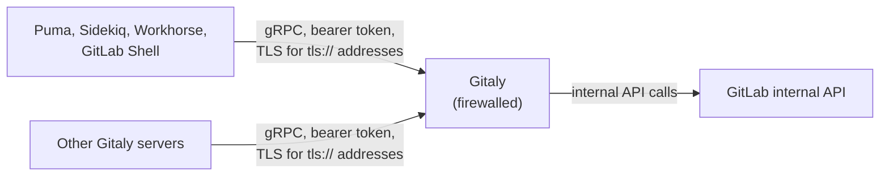

# Gitaly connections in a Zero Trust architecture

- Tier: Free, Premium, Ultimate
- Offering: GitLab Self-Managed

Though GitLab protects connections to Gitaly with a shared token and TLS, some gaps remain.

In a Zero Trust architecture, use both security-related Gitaly features and other controls
to cover those gaps. This information does not cover Gitaly Cluster (Praefect).

## Review how Gitaly secures connections

When Gitaly clients connect to a Gitaly:

- Gitaly authenticates callers with a shared token.
- Gitaly uses TLS to encrypt the connection and let GitLab verify the Gitaly server.
- Gitaly does not request or verify a client certificate.

### Authenticate clients with the Gitaly token

Gitaly clients send a bearer token that they sign with a password that you choose for Gitaly to check.
Gitaly and GitLab Rails nodes share the same token.

For more information, see [About the Gitaly token](configure_gitaly.md#about-the-gitaly-token).

Gitaly tokens:

- Carry no identity. Gitaly cannot tell which client sent a request.
- Are used to sign a timestamp for each request.
  Gitaly refuses a timestamp that is more than 30 seconds away from its own clock, in the past or the future.
- Are not required and if no token is configured, Gitaly does not check for one.
- Require an [auth transitioning](configure_gitaly.md#enable-auth-transitioning-mode) window on every
  Gitaly server for rotation. During auth transitioning, Gitaly accepts requests whose token does not match.

### Encrypt connections with TLS

Gitaly supports TLS on a separate listener, `tls_listen_addr`.
GitLab uses TLS when the storage address starts with `tls://` or `dns+tls://`.
For more information, see [Gitaly TLS support](tls_support.md).

With Gitaly TLS support enabled:

- GitLab verifies the Gitaly certificate against its trusted certificate authorities.
- Gitaly accepts TLS 1.2 or later by default.
- GitLab does not present a client certificate to Gitaly.

### Restrict network access to Gitaly

Unless you use TLS, Gitaly traffic is unencrypted and a Gitaly server must not be
exposed to the public internet.

Use firewall rules so that only the GitLab nodes and Gitaly servers that need Gitaly can reach its
listener.

To move clients to TLS gradually, run `listen_addr` and `tls_listen_addr` together.
After the move, remove `listen_addr` so that only the TLS listener remains.

## Cover the remaining gaps

Each of these gaps has a control that covers it.

- Gitaly accepts any client that holds the token and can reach the listener.
  To authenticate clients by certificate, use a service mesh or another network-layer control
  that enforces mutual TLS.
- Several components connect to Gitaly on their own: Puma, Sidekiq, Workhorse, GitLab Shell, and
  other Gitaly servers.
  Each of them holds the Gitaly address and token.
  To limit how far the token spreads:
  - On Gitaly servers, store it in a token file with `0600` or `0400` permissions.
    For more information, see [configure authentication](configure_gitaly.md#configure-authentication).
  - On GitLab Rails nodes, limit who can read `/etc/gitlab/gitlab.rb`, `/etc/gitlab/gitlab-secrets.json`,
    and the rendered `gitlab.yml`, which hold the token.
    In chart installations, limit who can read the Kubernetes Secret.
  - Use firewall rules so that only nodes that hold the token can reach Gitaly.
  - [Rotate the token](configure_gitaly.md#rotate-gitaly-authentication-token) when a node
    that held it is removed or exposed.
- Gitaly presents its server certificate as a client certificate to the GitLab internal API.
  That does not authenticate GitLab to Gitaly.
  The internal API authenticates Gitaly with the GitLab Shell secret, not the certificate.
  Give the secret only to nodes that need it.
  Use firewall rules so that only those nodes can reach the internal API.
  In a Helm chart installation, a service mesh can add mutual TLS to those calls.

## Use a service mesh in a Helm chart installation

In a Helm chart installation, an Istio service mesh can provide mutual TLS between GitLab
components and Gitaly.
For chart configuration, see
[Istio service mesh for the GitLab chart](https://docs.gitlab.com/charts/advanced/istio/).

With `PeerAuthentication` set to `STRICT`, in sidecar or ambient mode:

- Puma, Sidekiq, Workhorse, and GitLab Shell connect to Gitaly over mesh mutual TLS, including
  through the chart's headless Gitaly Service.
- A pod outside the mesh cannot connect to Gitaly.

In sidecar mode, Gitaly also calls the GitLab internal API over mesh mutual TLS.
