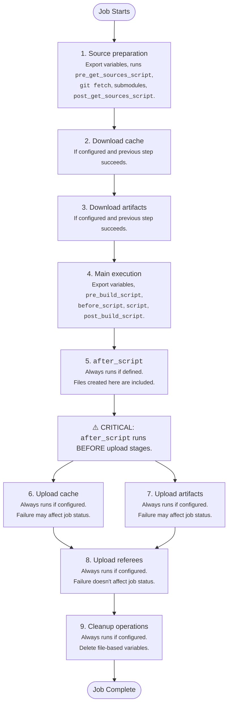

# Job execution flow

Job execution steps.

- Tier: Free, Premium, Ultimate
- Offering: GitLab.com, GitLab Self-Managed, GitLab Dedicated

The job execution flow describes how GitLab Runner processes CI/CD jobs from start to finish.

GitLab Runner executes CI/CD jobs after it receives a job, retrieves secrets from a vault
(if configured), and prepares the executor. Every CI/CD job executes as a series of sequential
steps, with each step running in a separate shell context. The runner:

1. Prepares the source code for the job:

   - Exports variables to the shell context
   - Runs `pre_get_sources_script` if it's defined in the configuration
   - Executes `git fetch` and other source handling commands, unless the `none` strategy is configured
   - Runs commands to update submodules if they exist
   - Runs `post_get_sources_script` if it's defined in the configuration

1. Downloads cached files if [cache](../yaml/_index.md#cache) is configured and the previous step succeeded:

   - Exports variables to the shell context
   - Executes commands to download cached files from previous job runs

1. Downloads [artifacts](../yaml/_index.md#artifacts) from previous jobs if artifact downloading is configured and the previous step succeeded:

   - Exports variables to the shell context
   - Executes commands to download artifact files from previous jobs

1. Executes the main job scripts if the previous step succeeded:

   - Exports variables to the shell context
   - Runs `pre_build_script` if it's defined in the configuration
   - Executes the `before_script` commands if they're defined
   - Executes the main `script` commands
   - Runs `post_build_script` if it's defined in the configuration

1. Executes `after_script` commands if they're defined, regardless of whether previous steps failed:

   - Exports variables to a new shell context
   - Executes the `after_script` commands
   - Failure of these commands doesn't influence the overall job status

1. Uploads files to cache if cache uploading is configured, regardless of whether previous steps failed:

   - Exports variables to the shell context
   - Executes commands to upload specified files to cache storage
   - Failure of this step may influence the overall job status

1. Uploads artifacts if artifact uploading is configured, regardless of whether previous steps failed:

   - Exports variables to the shell context
   - Executes commands to upload specified files as job artifacts
   - Failure of this step may influence the overall job status

1. Uploads referee data if referee uploading is configured, regardless of whether previous steps failed:

   - Exports variables to the shell context
   - Executes commands to upload referee information
   - Failure of these commands doesn't influence the overall job status

1. Performs cleanup operations if they're configured, regardless of whether previous steps failed:

   - Exports variables to the shell context
   - Executes commands to delete file-based variables from the working directory
   - Failure of these commands doesn't influence the overall job status



## Ref specs for runners

When a runner picks a pipeline job, GitLab provides that job's metadata. This includes the [Git refspecs](https://git-scm.com/book/en/v2/Git-Internals-The-Refspec),
which indicate which ref (such as branch or tag) and commit (SHA1) are checked out from your
project repository.

This table lists the refspecs injected for each pipeline type:

| Pipeline type                                        | Refspecs |
|------------------------------------------------------|----------|
| pipeline for branches                                | `+<sha>:refs/pipelines/<id>` and `+refs/heads/<name>:refs/remotes/origin/<name>` |
| pipeline for tags                                    | `+<sha>:refs/pipelines/<id>` and `+refs/tags/<name>:refs/tags/<name>` |
| [merge request pipeline](../pipelines/merge_request_pipelines.md) | `+<sha>:refs/pipelines/<id>` |
| [pipeline for workload refs](../pipelines/pipeline_types.md#workload-pipeline)  | `+<sha>:refs/pipelines/<id>` |

The refs `refs/heads/<name>` and `refs/tags/<name>` exist in your
project repository. The runner fetches the pipeline's commit SHA directly and stores it in the
local ref `refs/pipelines/<id>` in the job's clone. Because the fetch does not depend on a branch or tag,
it works even after the associated branch or tag has been deleted. Some features rely on this, such as
[automatically stopping an environment](../environments/_index.md#stopping-an-environment),
and [merge trains](../pipelines/merge_trains.md) that might run pipelines after branch deletion.

In GitLab 18.11 and earlier, the runner fetches `+refs/pipelines/<id>:refs/pipelines/<id>`
for merge request and workload pipelines instead of the commit SHA.

### `refs/pipelines/<id>` project ref (deprecated)

- Runners [stopped fetching](https://gitlab.com/gitlab-org/gitlab/-/merge_requests/235652) `refs/pipelines/<id>` in GitLab 19.0.

> [!warning]
> This ref was [deprecated](https://gitlab.com/groups/gitlab-org/-/work_items/21097) in GitLab 19.6.
> Fetch the commit SHA in `CI_COMMIT_SHA` instead. This change is a breaking change.

GitLab creates the `refs/pipelines/<id>` ref in your project repository for each pipeline,
but this ref is deprecated and might not be created in the future.
For more information, see
[issue 593383](https://gitlab.com/gitlab-org/gitlab/-/work_items/593383).

A race condition can cause fetches of this ref to fail intermittently with
`fatal: couldn't find remote ref refs/pipelines/<id>`.
Fetching the commit SHA does not have this problem.

If your scripts fetch or clone `refs/pipelines/<id>` from the remote, use the commit SHA
in `CI_COMMIT_SHA` instead. You should fetch the commit into a local ref, like the runner does:

```shell
git fetch origin "+${CI_COMMIT_SHA}:refs/pipelines/${CI_PIPELINE_ID}"
```

You can use any local ref name. Git only fetches tags that point to the fetched commits
automatically when the fetch updates a local ref.
If your scripts do not need tags, you can fetch the commit without a local ref:

```shell
git fetch origin "${CI_COMMIT_SHA}"
```

To clone the commit, use `git clone --revision`, which requires Git 2.49 or later:

```shell
git clone --revision "${CI_COMMIT_SHA}" "${CI_REPOSITORY_URL}"
```

For projects that use [SHA-256 hashing](../../user/project/_index.md#create-a-project-that-uses-sha-256-hashing),
set the object format, or the clone fails with `Remote revision <sha> not found in upstream origin`:

```shell
git -c init.defaultObjectFormat=sha256 clone --revision "${CI_COMMIT_SHA}" "${CI_REPOSITORY_URL}"
```

## Shell context isolation

Each shell context is isolated by design. The only connection between contexts is the shared working directory file system.

- Manual variable exports (like `export my_variable=$(date)`) in one context are not available in other contexts
- Each script runs with `set -eo pipefail` (for Unix shells) to fail early on the first error
- The outcome of each step influences whether subsequent steps execute and affects overall job status
