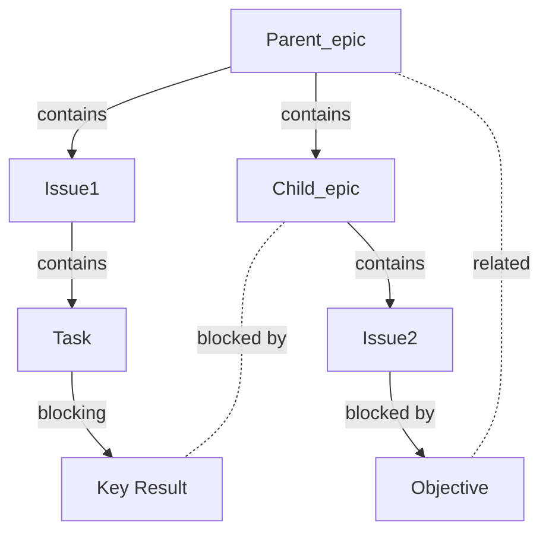

# Epics

Roadmaps, hierarchies, planning, and issue progress.

- Tier: Premium, Ultimate
- Offering: GitLab.com, GitLab Self-Managed, GitLab Dedicated

Epics in GitLab coordinate and track large initiatives by organizing work items into a work hierarchy.
Teams use epics in the following ways:

- Break down large features into smaller deliverables that add incremental value.
- Track the progress of related work items with scheduled start and end dates.
- Organize discussions and decisions about feature scope and requirements.
- Create hierarchical structures that connect tasks to strategic goals.
- Build visual roadmaps to monitor progress toward objectives.
- Coordinate work across multiple iterations.

In the Ultimate tier, [nested epics](../../work_items/child_items.md#work-with-multi-level-hierarchies) provide additional
structure through work hierarchies that align with agile frameworks.
Break down complex projects into child epics, which can contain their own issues and tasks.

  See the video: <a href="https://www.youtube.com/watch?v=c0EwYYUZppw">GitLab Epics - Setting up your Organization with GitLab</a>.

<figure class="video-container">
  <iframe src="https://www.youtube-nocookie.com/embed/c0EwYYUZppw" frameborder="0" allowfullscreen> </iframe>
</figure>

## Relationships between epics and other items

The possible relationships between epics and other items are:

- An epic is the parent of one or more issues.
- An epic is the parent of one or more [child epics](../../work_items/child_items.md#work-with-multi-level-hierarchies). Ultimate only.
- An epic is [linked](linked_epics.md) to one or more tasks, objectives, or key results.
- An epic can be assigned one [group milestone](../../project/milestones/_index.md).
  The epic's own milestone does not affect its dates.
- An epic can [inherit its start and due dates](manage_epics.md#start-and-due-date-inheritance)
  from its child items, including the milestones assigned to them.

Example set of relationships:

### Child issues from different group hierarchies

You can add issues from a different group hierarchy to an epic.
To add one, paste the issue URL when
[adding an existing issue](../../work_items/child_items.md#add-an-existing-issue-to-an-epic).

## Epics as work items

- [Introduced](https://gitlab.com/groups/gitlab-org/-/work_items/9290) in GitLab 17.2 [with a feature flag](../../../administration/feature_flags/_index.md) named `work_item_epics`. Disabled by default. Introduced in [beta](../../../policy/development_stages_support.md#beta).
- [Enabled on GitLab.com](https://gitlab.com/gitlab-org/gitlab/-/issues/470685) in GitLab 17.6.
- [Enabled by default on GitLab Self-Managed and GitLab Dedicated](https://gitlab.com/gitlab-org/gitlab/-/issues/468310) in GitLab 17.7.
- [Generally available](https://gitlab.com/gitlab-org/gitlab/-/issues/468310) in GitLab 18.1. Feature flag `work_item_epics` removed.

An epic is a type of [work item](../../work_items/_index.md),
so epics appear with issues, tasks, and other work items in the  list.

The [epics API](../../../api/epics.md) is deprecated.
To move your integrations, see [migrate epic APIs to work items](../../../api/graphql/epic_work_items_api_migration_guide.md).

## Related topics

- [Manage epics](manage_epics.md) and multi-level child epics.
- Link [related epics](linked_epics.md) based on a type of relationship.
- Create workflows with [epic boards](epic_boards.md).
- [Turn on notifications](../../profile/notifications.md) for epic events.
- [Add an emoji reaction](../../emoji_reactions.md) to an epic or its comments.
- Collaborate on an epic by posting comments in a [thread](../../discussions/_index.md).
- Use [health status](manage_epics.md#health-status) to track your progress.
- [Create epic templates](../../project/description_templates.md#create-a-description-template) to standardize epic descriptions.
